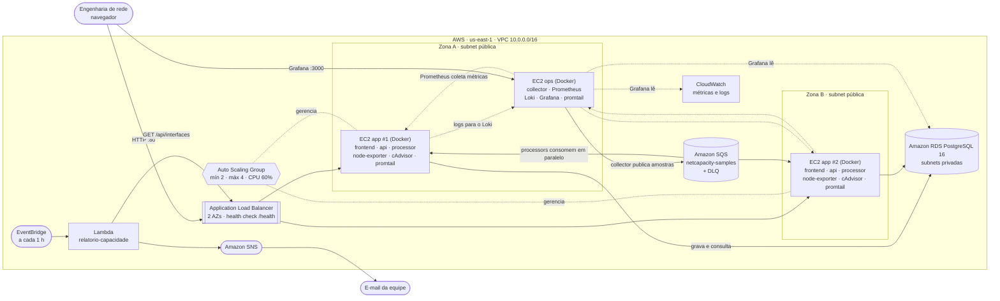

# Arquitetura da solução — NetCapacity v0.2

Desenho exportado com ícones AWS: [`docs/arquitetura.png`](arquitetura.png) (editável em `docs/arquitetura.drawio`).
O diagrama abaixo é a versão em código (renderizada automaticamente pelo GitHub).

## Ambiente

| Item | Valor |
|---|---|
| Nuvem / região | AWS Academy Learner Lab, `us-east-1` |
| Rede | VPC `10.0.0.0/16`; 2 subnets públicas (`10.0.1.0/24`, `10.0.2.0/24`) e 2 privadas (`10.0.11.0/24`, `10.0.12.0/24`) em `us-east-1a` e `us-east-1b` |
| Infraestrutura como código | Terraform (`infra/terraform`), aplicado pelo AWS CloudShell |
| Execução dos microserviços | Docker + Docker Compose em instâncias EC2 Amazon Linux 2023 |
| Imagens | Construídas em cada instância a partir do repositório Git (no boot) |

## Componentes

| Camada | Componente | Onde roda | Papel |
|---|---|---|---|
| Frontend | React + Nginx | Container nas instâncias app | Painel web; Nginx faz proxy de `/api` e `/health` |
| Backend | API FastAPI | Container nas instâncias app | `/api/summary`, `/api/interfaces`, `/api/alerts`, `/api/lags`, `/health`, `/metrics` |
| Backend | Processor | Container nas instâncias app | Consome a fila, calcula utilização, grava no banco, gera alertas ≥ 80% |
| Backend | Collector | Container na instância ops | Gera amostras (simuladas) dos uplinks e publica na fila |
| Mensageria | Amazon SQS + DLQ | Serviço gerenciado | Desacopla coleta e processamento; reprocessa falhas; DLQ após 5 tentativas |
| Banco de dados | Amazon RDS PostgreSQL 16 | Subnets privadas | Equipamentos, interfaces, métricas, alertas, LAGs |
| Serverless | Lambda + EventBridge + SNS | Serviços gerenciados | Relatório periódico "ação necessária" por e-mail |
| Entrada | Application Load Balancer | 2 AZs | Distribui tráfego só para instâncias saudáveis |
| Escala | Auto Scaling Group | 2 AZs | Mantém 2 instâncias; escala até 4 por CPU |
| Observabilidade | Prometheus, Loki, Grafana, node-exporter, cAdvisor, Promtail, CloudWatch | Instância ops + agentes nas app | Métricas, logs e dashboards |

## Fluxos

1. **Coleta (assíncrona):** collector (ops) gera 160 amostras por ciclo (40 equipamentos × 4 uplinks de 10G) → publica em lotes de 10 na fila SQS.
2. **Processamento (concorrente):** os processors das duas instâncias fazem *long polling* na fila; cada mensagem vai para um único processor → cálculo `utilização = max(RX, TX) / capacidade` → grava em `metrics`; se ≥ 80%, grava em `alerts` e registra log `capacity_alert`. Falha → a mensagem volta para a fila; após 5 falhas vai para a DLQ.
3. **Consulta:** usuário → ALB → Nginx (instância saudável) → API → RDS. A resposta traz o cabeçalho `X-Served-By` com a instância que atendeu.
4. **Relatório serverless:** EventBridge (1 h) → Lambda → `GET /api/interfaces` pelo ALB → filtra ≥ 80% → SNS → e-mail "AÇÃO NECESSÁRIA".
5. **Observabilidade:** Prometheus descobre as instâncias pela tag `Role=app` e coleta métricas; Promtail envia os logs de todos os containers ao Loki; Grafana mostra Prometheus, Loki, RDS e CloudWatch.

## Funcionalidades

- Painel com equipamentos, interfaces, uplinks ≥ 80%, média por tecnologia (GPON x HFC) e tabela filtrável.
- Alerta de expansão quando a interface atinge 80% (maior valor entre RX e TX).
- Estimativa de capacidade N-1 de LAGs (`/api/lags`, perda do maior membro).
- Relatório automático por e-mail com as interfaces que exigem expansão.
- Dashboards de capacidade (negócio) e de plataforma (técnico) no Grafana.
- Coletor SNMP real (`services/snmp_host.py`) para a rede de gerência autorizada, fora da nuvem.
