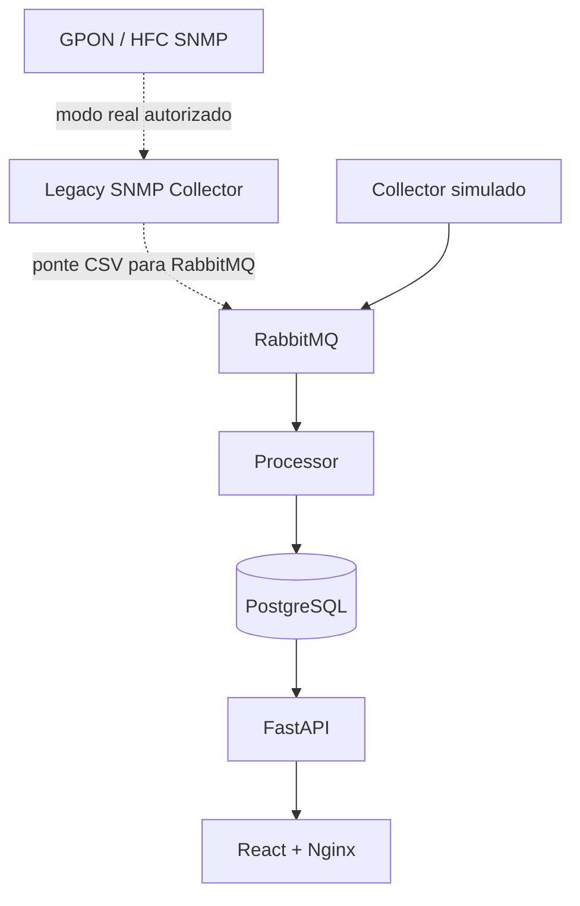

# NetCapacity — arquitetura MVP

- No MVP o modo Docker padrão é **simulated**. O legado SNMP é preservado mas **não é acionado automaticamente**.
- Os scripts originais mantêm descoberta de interfaces, amostragem de contadores e análise Excel.
- `services/import_legacy.py` transforma CSV de amostras reais em eventos do RabbitMQ (importação manual, ainda não validada ponta a ponta).
- SNMP só deve operar na rede de gestão autorizada. O arquivo original de inventário com IPs e comunidades não está no pacote distribuível.
- PostgreSQL armazena métricas, dispositivos e alertas. RabbitMQ desacopla o coletor do processador.
- A primeira versão **não implementa** N-1, alta disponibilidade, TimescaleDB, Terraform nem Grafana; são itens do roadmap.
